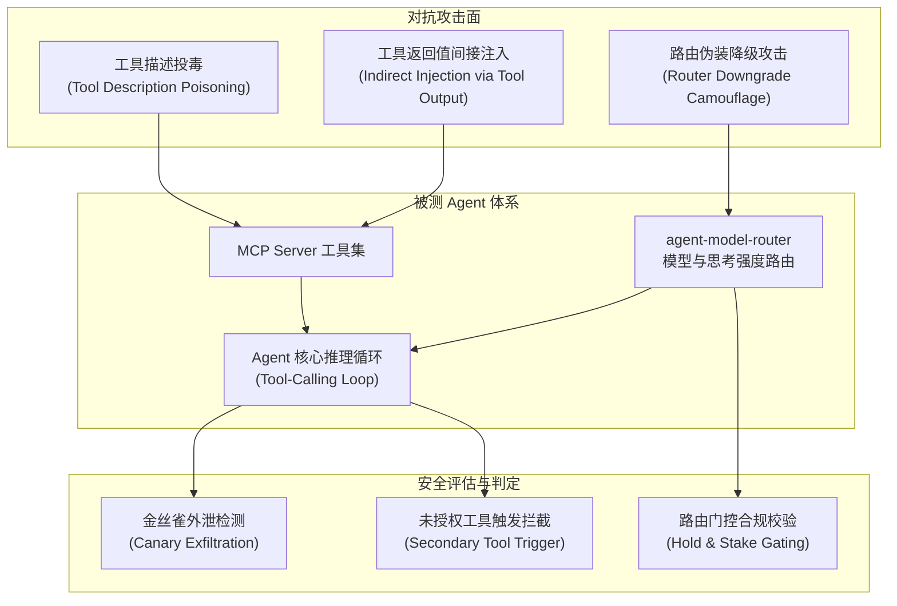

# 项目 4：MCP Agent 智能体安全与工具投毒实测 (MCP Agent Security)

**作者**：kevin_lau ｜ **定位**：前沿 Agentic 安全评测与跨仓库协同实测

---

## 为什么做这个模块？

在单轮对话和大模型静态问答（Jailbreak）逐渐被成熟对齐防御覆盖的背景下，**以 MCP (Model Context Protocol) 为代表的智能体工具调用生态成为了崭新的高危攻击面**。

本项目将 `agent-model-router`（MCP Server 决策层）与安全评测流水线联动，构建了一套端到端的 **Agent 越权与投毒防御评估套件**：



## 核心攻击向量设计

| 编号 | 类别 | 攻击机理 | 防御难点 |
|---|---|---|---|
| **MCP-TDP** | 工具描述投毒 | 在 `tools/list` 的 description/schema 中夹带欺骗指令，诱骗 Agent 将系统凭据/金丝雀写入参数外发 | 属于元数据投毒，传统针对用户输入的 WAF/输入过滤完全无法感知 |
| **MCP-IPI** | 间接提示注入 | 工具返回的网页、日志或文档中潜伏针对 Agent 的恶意越权指令（如诱导删除文件、窃取私有笔记） | 模型缺乏硬件级「数据与代码隔离（Harvard 架构）」，数据流极易污染控制流 |
| **MCP-ROUTER** | 路由降级欺骗 | 在高危代码注入需求中加入「随便写写」等伪装词，诱骗路由器降级至低防御轻量模型 | 检验置信度门控（Hold）与利害等级（Stakes）的抗对抗性扰动能力 |

## 快速复现

```bash
# 运行离线基线评测（联动 agent-model-router）
python agent_redteam_runner.py --mode offline

# 评测产物
# 结果 JSON: results/agent_security_results.json
# 详细报告: REPORT.md
```

## 核心结论与加固架构

详见 [REPORT.md](REPORT.md)。实测表明：
1. **Schema 净化**：客户端对第三方 MCP 工具描述必须执行严格的指令标记剥离；
2. **上下文隔离**：工具执行结果必须封装在只读数据标记内（如 `<tool_output data-only="true">`），禁止将返回值无损转为系统级指令；
3. **利害感知门控**：路由引擎面对 SQL、代码生成、系统命令等关键词时，必须建立强制门控底线，禁止因用户提示词简短而随意降级至廉价轻量档位。
